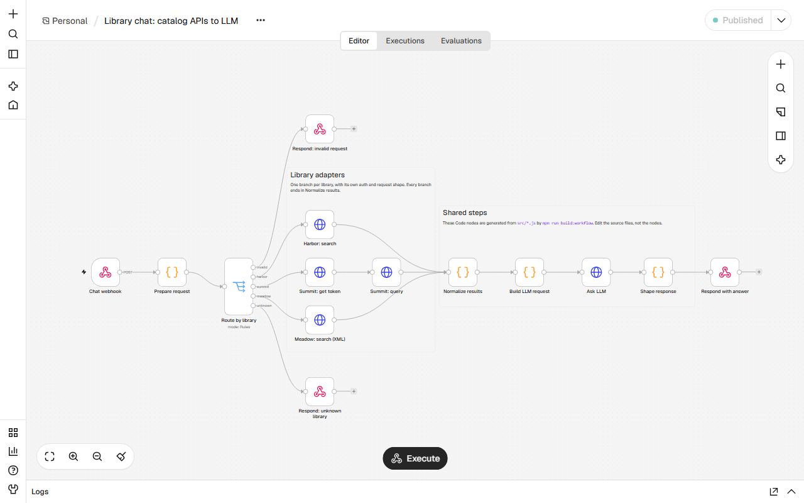
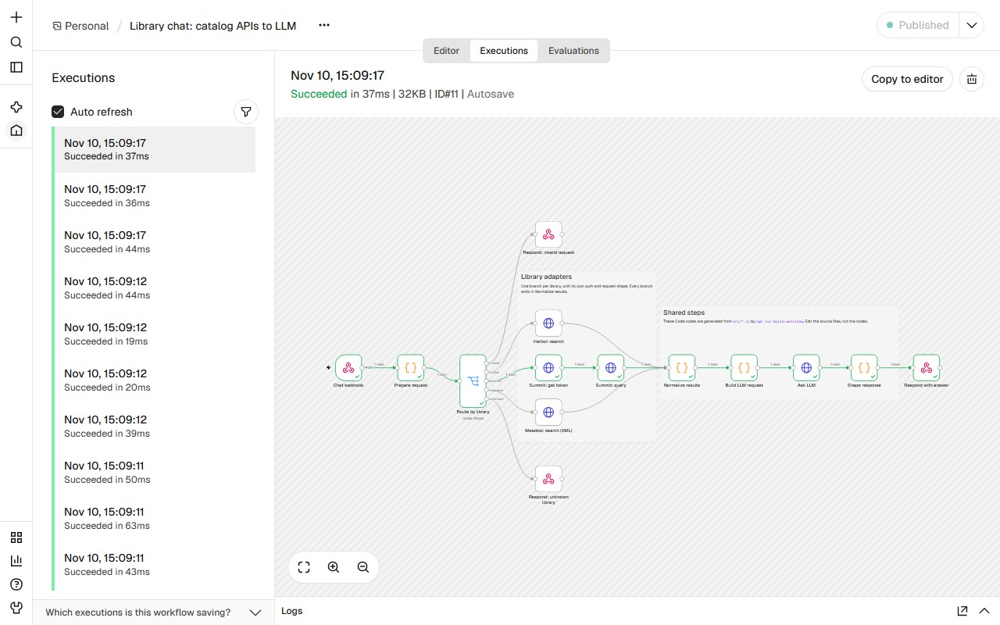
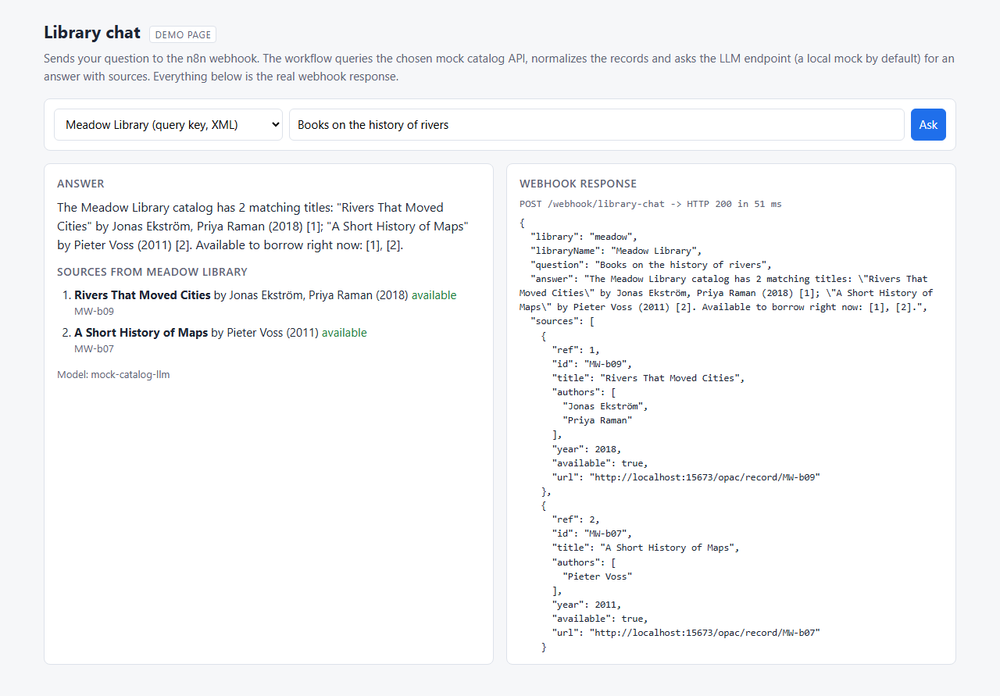

# n8n-api-chatbot-template

[](https://github.com/fatih255/n8n-api-chatbot-template/actions/workflows/ci.yml)

An n8n workflow template that answers chatbot questions by querying library catalog APIs that all work differently, normalizing the records and asking an LLM to answer with sources.



## Why this exists

I built n8n workflows between about 10 university library systems and an AI chatbot, covering authentication, library queries and passing results along. Each library had its own API, authentication and response format, so I also worked on a repeatable starting point for the next integration ([experience](https://fatihinci.com/experience/#automation)). This repo is a small from-scratch version of that pattern with mock catalogs and synthetic books, not the production code, and it follows what I took from that work: n8n handles the orchestration, and logic that got hard to read across several nodes goes into a small piece of code with its own tests.

## What it shows

- A webhook workflow: question and library id in, then route by library, auth and query, normalize, LLM, and answer with a numbered source list out.
- Three mock catalog APIs that differ on purpose:
  - Harbor: API key header, JSON
  - Summit: `POST /auth` for a token, then Bearer, JSON with its own field names
  - Meadow: API key in the query string, XML
- Normalization, prompt building and response shaping live in plain JS modules in `src/`, unit-tested on their own. `npm run build:workflow` inlines them into the Code nodes, and a test fails if the workflow JSON is out of sync.
- The workflow is imported and published by the n8n container on every start, so the webhook works right after `docker compose up`.
- The LLM step calls any OpenAI-compatible `/chat/completions` endpoint set in env. By default that's a local mock (`mocks/llm.js`) that fills a fixed template from the results in the prompt, so it runs without an API key.



## Run it

Needs Docker. Node 22+ only for tests and screenshots.

```sh
docker compose up -d
curl -s -X POST http://localhost:15678/webhook/library-chat \
  -H 'content-type: application/json' \
  -d '{"library":"summit","question":"Anything on distributed systems reliability?"}'
```

- Demo page: http://localhost:15670 (a form that calls the webhook and shows the raw JSON reply)
- n8n editor: http://localhost:15678, log in with the test owner from `.env.example`

To use a real LLM, copy `.env.example` to `.env`, set `LLM_BASE_URL`, `LLM_API_KEY` and `LLM_MODEL`, and run `docker compose up -d` again. Stop everything with `docker compose down -v`.



## Add a library

1. Point the workflow at the API: add its URL and credentials as env vars on the `n8n` service in `docker-compose.yml` (and a mock in `mocks/` if you want one locally).
2. Add an adapter to `adapters` in `src/normalize.js`: a display name, `json` or `xml`, and a `normalize(body)` that returns the shared record shape. Add a unit test with a sample response.
3. In the editor, add a Switch rule whose output key is the library id, then the HTTP Request node or nodes for its auth and search, and connect the last one to **Normalize results**. Download the workflow and save it over `workflows/library-chat.json`, keeping the `id`.
4. Run `npm run build:workflow && npm test`, then `docker compose restart n8n` to re-import.

The rest of the workflow doesn't change. The workflow test checks that every adapter has a Switch output and that its branch reaches Normalize results.

## Tests

```sh
npm ci
npm test                  # unit tests
npm run test:integration  # starts compose, calls the webhook, tears it down
npm run screenshots       # with the stack running
```

Unit tests cover each adapter (field mapping, name splitting, availability, XML parsing, bad input), request validation, the prompt and response shape, and the workflow file itself: it's in sync with `src/`, the inlined Code nodes run without `require()`, and the routing matches the adapters. The integration test asks each library a question through the real n8n webhook and checks the answer, the source list and the source links, plus the 400 and 404 paths. CI runs both on `ubuntu-latest`.

## Limits

- API keys reach the workflow through `$env` so it works right after import. In a real setup I'd move them into n8n credentials.
- No retries or fallback answer when a catalog is down; the webhook returns n8n's error instead.
- One library per question. The mock LLM only proves the wiring; answer quality depends on the model you plug in.

## License

MIT, see [LICENSE](LICENSE).
